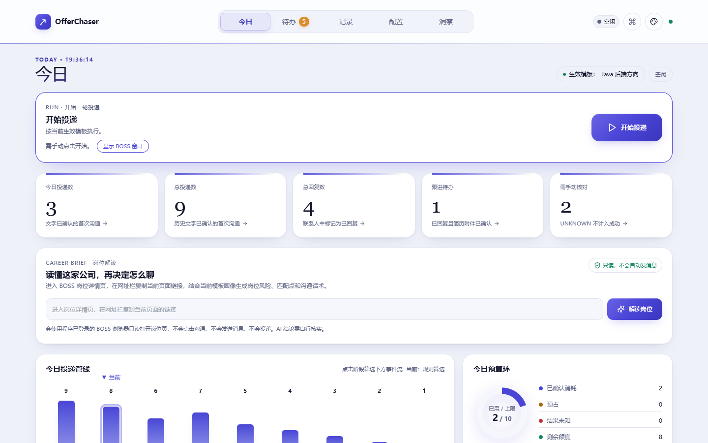
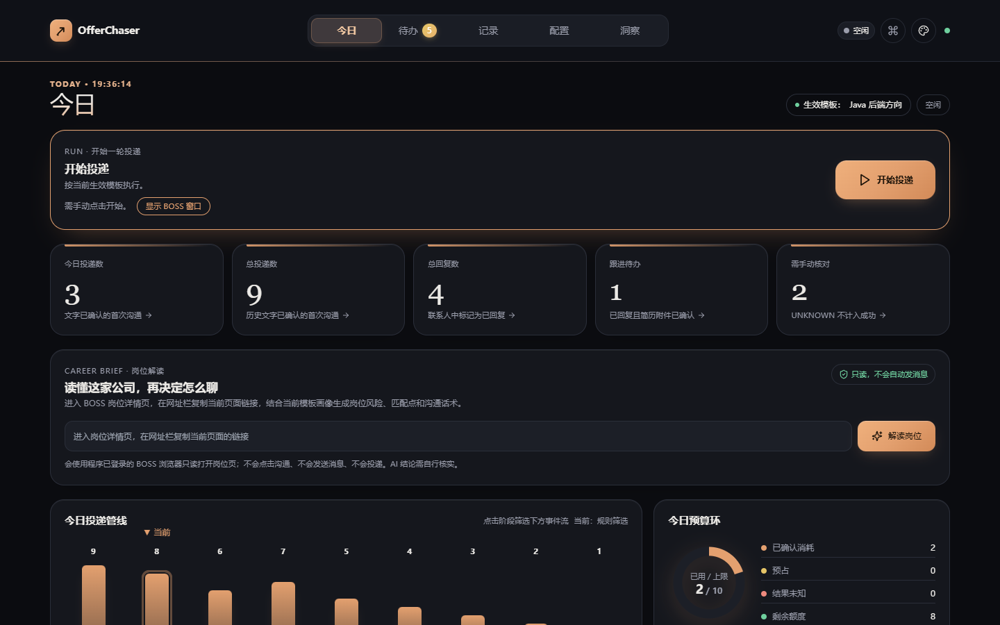
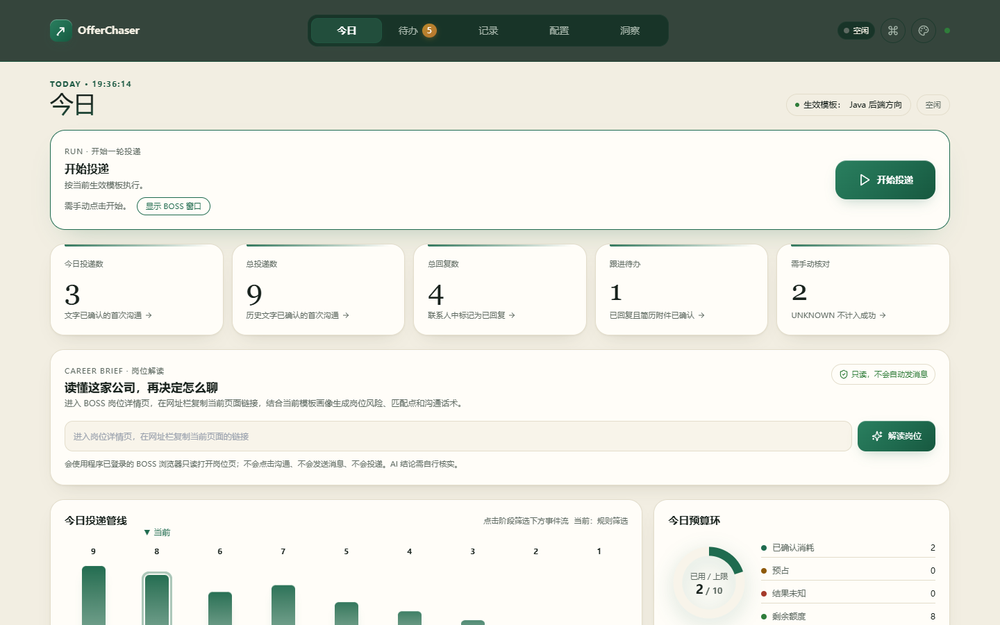
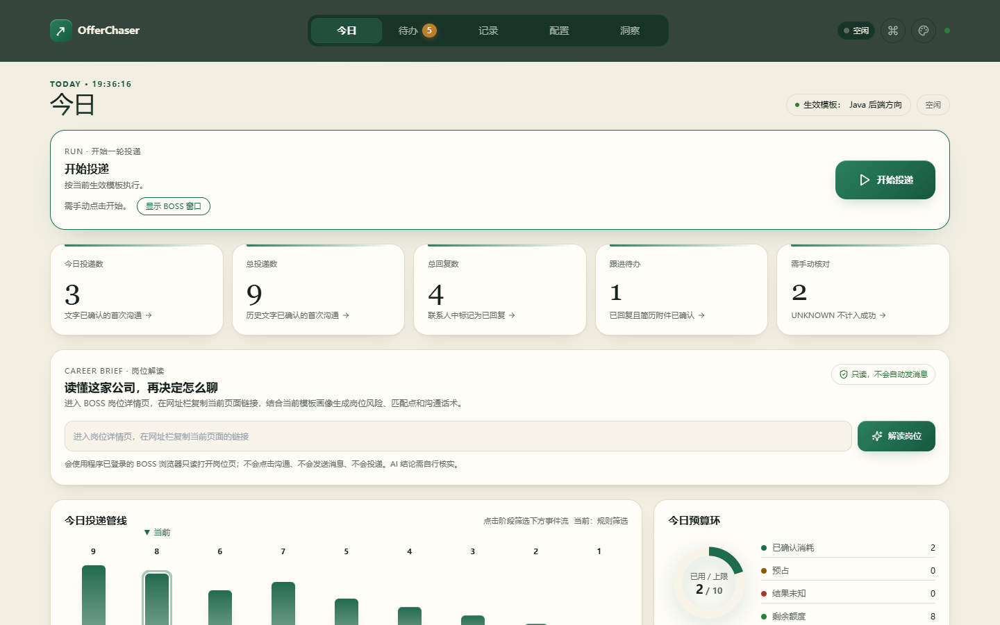
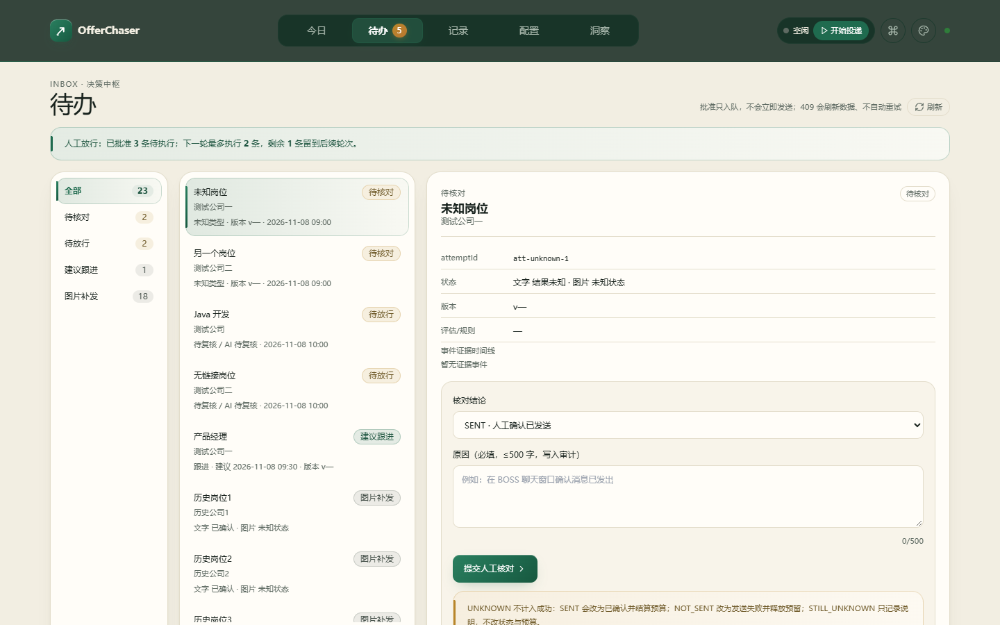
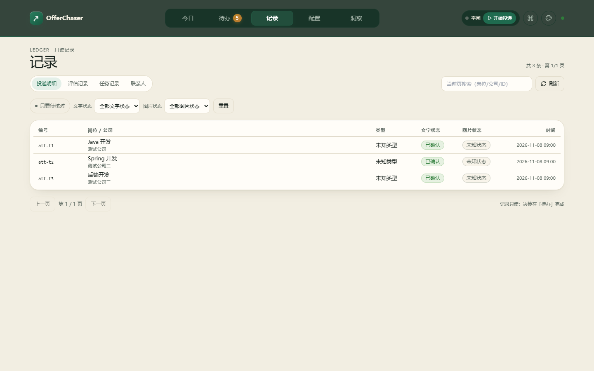
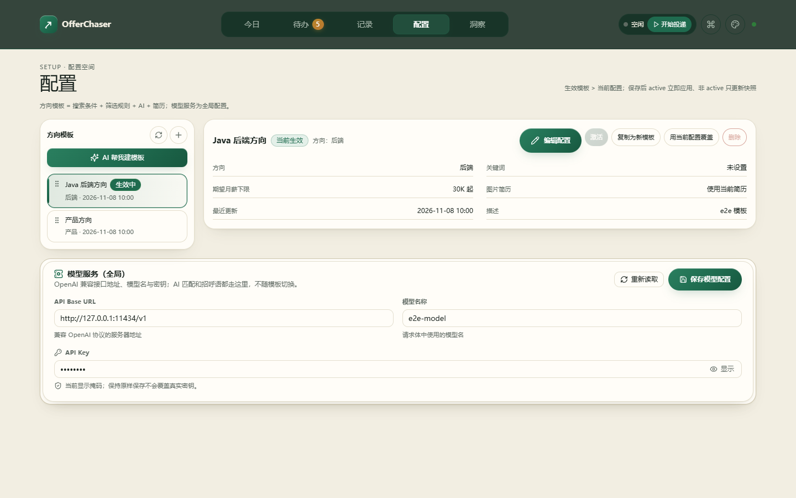
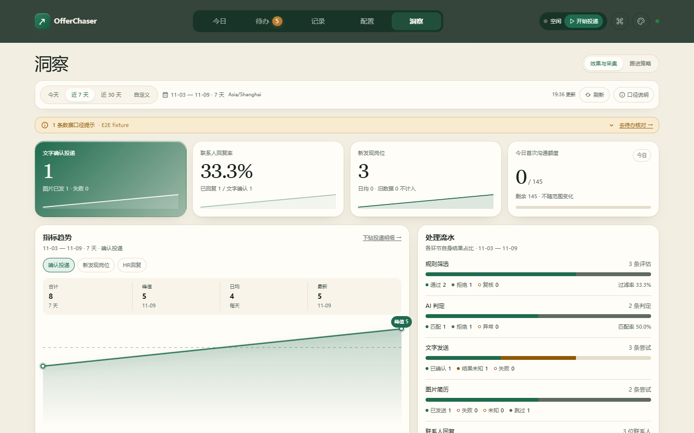

# OfferChaser

> 这个项目使用了开源项目 [loks666/get_jobs](https://github.com/loks666/get_jobs)：Spring Boot 骨架和 BOSS 直聘的自动化链路。
>
> 业务层167 个类里 118 个是新写的：规则引擎、AI 匹配和话术、额度预留、审计台账、人工待办、方向模板、洞察、岗位解读、本机会话。
>
> 版权：上游部分归 GET JOBS（2024-2026），新增和改写的部分归本人（2026）。  
> 许可证：PolyForm Noncommercial License 1.0.0，仅限非商业用途。
>
> 转发或者打包分发的时候，这两行请原样留着：  
> Required Notice: Copyright (c) 2024-2026 GET JOBS (https://github.com/loks666/get_jobs)  
> Required Notice: Copyright (c) 2026 Yhmx6 (https://github.com/Yhmx6/OfferChaser)
>
> 碰到问题请提到[我的仓库](https://github.com/Yhmx6/OfferChaser)。

**跑在自己电脑上的 BOSS 直聘投递助手。**

它替你干这几件事：按条件搜岗位、按规则筛掉不合适的、让模型判断值不值得聊、写一段针对这个岗位的招呼语、把简历发过去，再把每一步记下来。

一条投递走完是这样：

```text
采集岗位
→ 本地规则
→ AI 匹配与话术
→ 联系人复检
→ 每日首次沟通额度预留
→ 会话身份核对
→ 文字发送确认
→ 图片简历确认
→ 台账 / 状态同步 / 洞察
```

全程在本机。数据库是一个 SQLite 文件，BOSS 的登录态放在 `browser-data/`。

当前版本 **2.0.1**。管理台默认免登录，只监听 `127.0.0.1`。

---

## 交流群

使用问题、投递策略、规则调优，欢迎进群一起聊：

- **群名**：OfferChaser交流群
- **群号**：1126859628

QQ 扫码进群：

<p align="center">
  
</p>

---

## 为什么写这个

每天要点几十个岗位，翻 JD、判断合不合适、想一句开场白，再一个个发出去。做完一轮人已经累了，第二轮就不想做了。

把这层重复劳动交出去，同时把三件该留在手上的事留住：

- **发不发由我定。** 每次投递都要我点开始；规则或模型判成「待定」的岗位，要我批了才进队列。
- **发过的能查。** 每条投递、每次评估、每个决定都落库，事后能回答「这条为什么发了」「这条为什么没发」。
- **拿不准就停。** 身份对不上、额度不够、发送结果没确认，流程停在原地等我，由我决定下一步。

---

## 默认设置

- 岗位之间等 **3 秒**。
- 模型服务默认指向 `https://api.deepseek.com`，模型 `deepseek-flash`，API Key 留空等你填。
- 招呼语、重复沟通消息、AI 提示词都给了通用模板，改成你自己的就能用。
- 首次启动自动补齐 BOSS 的城市、行业等选项字典（约 579 条），开箱可用。

---

## 发不发，谁说了算

一条投递要连过六道关，任何一道没过就停住：

1. **本地规则。** 学历、薪资区间、方向、城市、黑名单、HR 活跃度、是否聊过，先按死规则筛一遍，输出 PASS / REJECT / REVIEW。这一步不碰浏览器、不发消息。
2. **AI 匹配。** 只让它输出四种结论：MATCH / REJECT / REVIEW / ERROR，格式不对直接判失败。
3. **联系人复检。** 发之前再看一眼这个人有没有聊过、有没有回复、有没有被接管。
4. **额度预留。** 每日首次沟通和跟进分开记账，原子预留，结果未知的先占着不释放。
5. **会话身份核对。** 打开的聊天窗口里，HR、岗位、公司三项对得上才继续。
6. **发送确认。** 文字等 15 秒、图片等 45 秒，各自独立确认；结果未知的一律按「没确认」处理。

人工放行不会跳过这六道关。批准只是让它进队列，轮到执行时照样从第 1 关重新走一遍。

---

## 功能

### 1. 采集与规则

- 按关键词、城市、行业、经验、学历、薪资、规模、融资阶段、职位类型组合搜索。
- 采集有上限：每个关键词最多多少条、最长采多久、连续多久没新岗位就提前收工。
- 岗位去重，同时记录来源。
- 硬规则覆盖学历、薪资区间、方向、城市、黑名单、HR 活跃度、联系人去重，输出 PASS / REJECT / REVIEW 三态。

### 2. AI 匹配与话术

- 接任意 OpenAI 兼容接口，填 base URL 和 key 就能用。
- 只认严格 JSON，四种结论：MATCH / REJECT / REVIEW / ERROR。
- 话术有长度和开头约束，要求提到岗位里具体的东西。
- 模型超时、报错、输出不合格式，这条就跳过并记下原因。话术只由模型产出，不用模板硬凑。

### 3. 发送

- 身份核对看三项：HR、岗位、公司，任何一项对不上或看不清就停。
- 文字单独确认（15 秒），图片简历单独确认（45 秒）。
- 每日首次沟通和跟进分两本账，原子预留；连续失败会熔断。
- 发送前再复检一次联系人状态。

### 4. 待办

- **待核对**：结果未知的投递，你来确认是 SENT / NOT_SENT / STILL_UNKNOWN。
- **待放行**：规则或模型判成 REVIEW 的岗位，批准后进队列。
- **建议跟进**：批准后放到下一轮执行。
- **图片补发**：文字确认了但图片失败或未知时，生成补发计划。
- **一键清理**：把待核对统一标成 STILL_UNKNOWN，只清列表，不结算、不释放额度，每条都写审计。
- **有效沟通**：认出 HR 已回复或面试中、且简历附件确认送达的，列出公司、岗位、薪资和岗位页链接。

### 5. 模板

- 一个方向模板装下：搜索条件、筛选规则、AI 介绍和提示词、图片简历、采集策略、投递开关。
- 激活后从下一轮开始生效。
- AI 建模板：上传简历、粘文本，或者手写优势技能 → 出画像 → 给方向和薪资建议 → 几轮问答 → 生成草稿。
- 补充说明最多 1000 字，只用于这次分析，不保存。
- 草稿生成后默认停在草稿状态，你确认了再激活。
- 保存时没动过的 AI 文本不会回写，避免把全局提示词覆盖掉。

### 6. 岗位解读

粘一条 BOSS 岗位链接，只读生成一份解读：公司、岗位、薪资、地点、经验、学历，这个岗位真正看重什么，你哪里匹配、哪里缺，岗位和公司的风险（标了需自行核实），怎么开口，第一句话怎么说，HR 追问怎么回，该反问什么，第一次沟通先别提什么。

生成过程只读页面，消息、投递、联系人都不碰。链接里的 `securityId` 用完即弃、不落库。只接受 BOSS `/job_detail/` 链接。结论都带「需自行核实」。

### 7. 洞察

- 一页 H1「洞察」，右边切页签。
- 顶部工具栏吸顶：范围、刷新、更新时间、口径说明。
- 四张结果卡：确认投递、回复率、新发现岗位、今日首次沟通额度。
- 趋势只给三条：确认投递、新发现岗位、HR 回复。
- 处理流水按环节列：规则筛选、AI 判定、文字发送、图片简历、联系人回复。
- 采集概况六格；明细可以按日看，也可以按关键词看。
- 口径说明收在抽屉里，点开能看到每个数字怎么算出来的。口径只算环节内能直接对上的数。
- 只有一天的数据就只显示数字不画趋势；全是零就显示零。
- 结果未知的单独用一个颜色标出来；被规则拒掉的用中性色，不用红色。

### 8. 管理台

- 五个空间：今日 / 待办 / 记录 / 配置 / 洞察。
- 桌面用顶部导航，窗口窄于 820px 换成底部导航。
- 三套主题：瓷白靛、石墨铜、象牙松。
- 弹窗统一走 DialogShell，带焦点陷阱，键盘能从头走到尾。
- 默认免登录；想开认证在配置里打开就行。

---

## 页面预览

> 截图使用 E2E 模拟数据，不包含真实账号、API Key、简历、岗位或投递记录。主要页面使用象牙松（绿色）配色。

### 首页三套配色

| 瓷白靛 | 石墨铜 | 象牙松（绿色） |
|:---:|:---:|:---:|
|  |  |  |

### 五个主空间（象牙松）

| 今日 | 待办 | 记录 |
|:---:|:---:|:---:|
|  |  |  |

| 配置 | 洞察 | |
|:---:|:---:|:---:|
|  |  | |

更多子页面截图见 [doc/screenshots/README.md](doc/screenshots/README.md)。

## 技术栈

| 层 | 技术 |
|---|---|
| 后端 | Java 21、Spring Boot 3.5.16、MyBatis-Plus |
| 数据库 | SQLite（xerial JDBC），schema V13 |
| 浏览器自动化 | Playwright Java 1.62 + Patchright |
| 前端 | Next.js 16 静态导出、React 19、Tailwind、本地 UI 组件 |
| 图表 | 本地 SVG / CSS 渲染 |
| 启动 | Windows 托盘启动器 / PowerShell |

---

## 快速开始

### 环境

- Windows 10/11 **x64**；
- **GitHub 仓库是源码，不是一键发布包**：不含 `runtime/`、`.jdk/`、`node/`、`patchright-driver/`、前端 `dist/` 和数据库；
- 跑源码需要 JDK 21、Node.js 20+（含 corepack/pnpm）和 Google Chrome；
- 桌面包才自带 JDK/Node/Patchright，拿到发布包的人不需要另装 Java/Node。

### 桌面包启动（如果你拿到的是发布包）

双击：

- `OfferChaser.vbs`：托盘后台启动；
- `停止OfferChaser.vbs`：停止服务。

启动后：

- 管理台：<http://127.0.0.1:6866>
- 后端 API：<http://127.0.0.1:9527>

首次启动大概 3–15 秒。日志在：

- `target/logs/launcher.out.log`
- `target/logs/launcher.err.log`
- `target/logs/offerchaser.log`

### 从 GitHub 源码启动

**不要直接双击 `OfferChaser.vbs`**：源码仓库没有 JDK、Node、Patchright 和预构建前端。直接双击通常会在启动阶段报错。

先安装：

- JDK 21；
- Node.js 20+（带 corepack；`gradlew bootRun` 会自动构建前端）；
- Google Chrome。

然后执行：

```powershell
git clone https://github.com/Yhmx6/offerchaser.git
cd offerchaser
powershell -ExecutionPolicy Bypass -File .\start-local.ps1
```

`start-local.ps1` 会：

- 检查 JDK；
- 首次运行时把仓库里干净的 `db/offerchaser.db.template` 复制成 `db/offerchaser.db`；
- 运行 `gradlew bootRun`，首次会下载依赖并构建前端。

打开 <http://127.0.0.1:6866/boss>。源码方式首次启动会比桌面包慢。

> 如果只是浏览源码/文档，直接下载不会报错；只有想运行才需要上面的环境。

### 首次配置

1. 打开管理台。默认不用登录；如果开了认证，令牌在 `data/local-session-token`。
2. 配模型服务。`BASE_URL=https://api.deepseek.com` 和 `MODEL=deepseek-flash` 已经填好，通常只差你自己的 API Key。
3. 建一个方向模板，或者用「AI 帮我建模板」。城市、行业、经验、学历、薪资、规模、融资阶段这些选项字典首次启动就补齐了（约 579 条），不用手动导。
4. 传图片简历，顺手核一下关键词、规则、城市、薪资区间。
5. 点开始。真实投递从这一步才开始。

---

## 开发

### 常用命令

```powershell
cd <项目目录>
$env:JAVA_HOME='<项目目录>\.jdk\jdk-21.0.13+9'
.\gradlew.bat clean test
```

前端：

```powershell
cd <项目目录>\front
node node_modules/next/dist/bin/next build
node scripts/copy-dist.mjs
npm run lint
```

改完前端要跑一次 `copy-dist` 再重启后端，静态资源才会更新。

### 当前门禁基线

- 全量测试：**1118 tests / 0 failures / 0 errors / 54 skipped / 119 classes**
- UI E2E：**19/19**
- `next build` 通过
- lint：0 errors / 0 warnings
- 服务健康：`UP`

> 数字以最近一次实际门禁为准，详见 [`doc/05-testing.md`](doc/05-testing.md)。

### 打包发布

别把整个目录压缩发出去。`db/`、`data/`、`browser-data/`、`target/` 里是你的 API Key、简历、BOSS 登录态和运行日志。

用脚本打：

```powershell
.\build-release.ps1              # 生成 release\OfferChaser-2.0.1\
.\build-release.ps1 -Zip         # 额外压成 zip
.\build-release.ps1 -CheckOnly   # 只做前置检查，不生成任何东西
```

脚本按白名单拷文件，把 `LICENSE` 和 `NOTICE` 注入 jar 的 `META-INF`，然后在打包后自检：一旦发现敏感目录或缺少许可证就直接失败。

> PowerShell 默认禁止运行脚本。如果报 `UnauthorizedAccess`，先用 `Set-ExecutionPolicy -Scope Process Bypass` 放行当前窗口。

---

## 项目结构

```text
OfferChaser/
├─ src/main/java/com/offerchaser/
│  ├─ application/      业务：任务、规则、AI、联系人、额度、模板、洞察
│  ├─ worker/           BOSS 自动化执行层
│  └─ controller/       REST / SSE
├─ src/main/resources/
│  ├─ application.yaml  配置
│  └─ dist/             前端构建产物（由 copy-dist 生成）
├─ front/               Next.js 管理台
├─ doc/                 架构、API、安全、测试、UI、PRD
├─ db/                  SQLite（本机敏感数据，提交时排除）
├─ data/                模板/简历/运行数据（提交时排除）
├─ browser-data/        BOSS 登录态（提交时排除）
├─ OfferChaser.vbs      托盘启动
└─ 停止OfferChaser.vbs   停止服务
```

---

## 安全与隐私

- 服务只监听 `127.0.0.1`。
- 后端会校验 HTTP Host，只允许 `127.0.0.1`、`localhost`、`::1`；用局域网 IP 或自定义域名访问会被 403，这是防 DNS rebinding 的边界。
- 默认免登录是为了本机用着方便。`6866` 和 `9527` 都只在回环上，做端口映射就等于把它挂到公网了。
- 想恢复登录：把 `offerchaser.security.auth-enabled` 设成 `true`。
- `.env`、`data/`、`db/`、`browser-data/` 和日志里有敏感信息，提交前记得排除。
- Cookie 和 API Key 在界面上只显示掩码。
- 岗位解读全程只读。
- 碰到平台验证就停下来，等你人工处理。

---

## 现在的边界

- 只接 BOSS 直聘。
- 数据和登录态都在本机，换一台电脑要重新配置、重新扫码。
- 投递要你点开始，没有定时任务。
- HR 回复和跟进都等你决定；图片补发只出计划，执行还是你来。
- 岗位解读的依据是岗位页本身，外部新闻、工商信息、面经还没接。
- BOSS 改 DOM 会让解析和发送失败，这时候流程会停住等你处理。
- 状态同步看页面能读到什么，不保证实时。
- 模板改了就覆盖，还没有版本回滚。

---

## 法律与使用边界

OfferChaser 是个人、本机、非商业项目，与 **BOSS 直聘**、**DeepSeek**、**get_jobs** 均无隶属、合作、授权或背书关系。浏览器自动化可能违反平台用户协议或触发风控；请自行阅读并遵守平台规则，不要用于骚扰、虚假招聘、抓取他人信息或其他违法用途。

非商业许可、上游归属和完整边界见 [LICENSE](LICENSE)、[NOTICE](NOTICE) 与 [DISCLAIMER.md](DISCLAIMER.md)。

## 文档

| 文档 | 内容 |
|---|---|
| [`AUTHORS.md`](AUTHORS.md) | 作者与贡献划分 |
| [`ATTRIBUTION.md`](ATTRIBUTION.md) | 上游致谢与许可证说明 |
| [`NOTICE`](NOTICE) | 上游归属、商业授权路径、分发要求 |
| [`doc/14-open-source-compliance.md`](doc/14-open-source-compliance.md) | 逐文件清单与合规判定依据 |
| [`项目说明.md`](项目说明.md) | 产品与运维手册 |
| [`doc/README.md`](doc/README.md) | 文档索引 |
| [`doc/01-architecture.md`](doc/01-architecture.md) | 架构与模块 |
| [`doc/02-runtime-data.md`](doc/02-runtime-data.md) | 运行与数据模型 |
| [`doc/03-api.md`](doc/03-api.md) | API 清单 |
| [`doc/04-security.md`](doc/04-security.md) | 安全不变量 |
| [`doc/05-testing.md`](doc/05-testing.md) | 测试体系 |
| [`doc/06-operations.md`](doc/06-operations.md) | 运维与排障 |
| [`doc/07-ui-design.md`](doc/07-ui-design.md) | UI 设计系统 |
| [`doc/08-roadmap.md`](doc/08-roadmap.md) | 路线图与已知限制 |
| [`doc/09-frontend-ui-contract.md`](doc/09-frontend-ui-contract.md) | 前端交接契约 |
| [`doc/10-ui-redesign-v3.md`](doc/10-ui-redesign-v3.md) | V3 UI 规格 |
| [`doc/11-beginner-guide.md`](doc/11-beginner-guide.md) | 新手快速上手 |
| [`doc/12-product-prd.md`](doc/12-product-prd.md) | 从 0 到当前版本的完整 PRD |
| [`doc/13-environment-compatibility.md`](doc/13-environment-compatibility.md) | 换电脑/全新安装的兼容性边界 |
| [`doc/guides/README.md`](doc/guides/README.md) | 从配置到投递的 4 步图解使用说明 |
| [`DISCLAIMER.md`](DISCLAIMER.md) | 法律、平台规则、隐私与非商业许可边界 |

---

## 开源、衍生与许可证

上游是 [loks666/get_jobs](https://github.com/loks666/get_jobs)，作者 loks666，版权 2024-2026 GET JOBS，许可证 PolyForm Noncommercial 1.0.0。

| 范围 | 数量 | 具体是什么 |
|---|---|---|
| 我新写的 | 118 / 167 个类 | 规则引擎、AI 严格 JSON 校验、会话身份核对、额度预留、审计台账、人工待办、跟进计划、方向模板、洞察、岗位解读、本机会话 |
| 从上游沿用 | 49 / 88 个类 | `application/{config,entity,mapper,service,controller,init}` 骨架和 `worker/{boss,utils,manager,service,dto}` 执行层，路径和类名没动，只换了包名 |
| 从上游删掉 | 39 个类 | 51job、猎聘、智联三套平台实现，加上 `Bot`、`Platform` 和原入口类 |
| 前端 | — | `/boss`、`/boss/analysis`、`/ai-config` 三个路由和 `copy-dist` 脚本沿用上游，其余 15 个页面重写 |

### Required Notice

```text
Required Notice: Copyright (c) 2024-2026 GET JOBS (https://github.com/loks666/get_jobs)
Required Notice: Copyright (c) 2026 Yhmx6 (https://github.com/Yhmx6/OfferChaser)
```

### 商业使用

上游部分和我写的部分授权是分开的：

- 上游部分只有 GET JOBS 能授权（通过上游仓库联系）；
- 新增和改写的部分由我授权，[到仓库提个 issue](https://github.com/Yhmx6/OfferChaser) 就行。

### 分发

`LICENSE` 和 `NOTICE` 要跟着走。只发 `OfferChaser.jar` 也算分发，jar 里也得带上这两个文件。

逐文件清单、判定依据和合规自检项都在 [`doc/14-open-source-compliance.md`](doc/14-open-source-compliance.md)；上游归属声明见 [NOTICE](NOTICE) 和 [ATTRIBUTION.md](ATTRIBUTION.md)。

## 作者认证

项目由 [@Yhmx6](https://github.com/Yhmx6) 维护。

## License

**PolyForm Noncommercial License 1.0.0**。完整许可证见 [LICENSE](LICENSE)。

```text
Required Notice: Copyright (c) 2024-2026 GET JOBS (https://github.com/loks666/get_jobs)
Required Notice: Copyright (c) 2026 Yhmx6 (https://github.com/Yhmx6/OfferChaser)
```
