# 页面截图

所有截图来自 **E2E 模拟数据环境**，用于说明界面结构，不包含真实账号、API Key、简历、岗位或投递记录。

## 首页三套配色

| 瓷白靛 | 石墨铜 | 象牙松 |
|:---:|:---:|:---:|
| 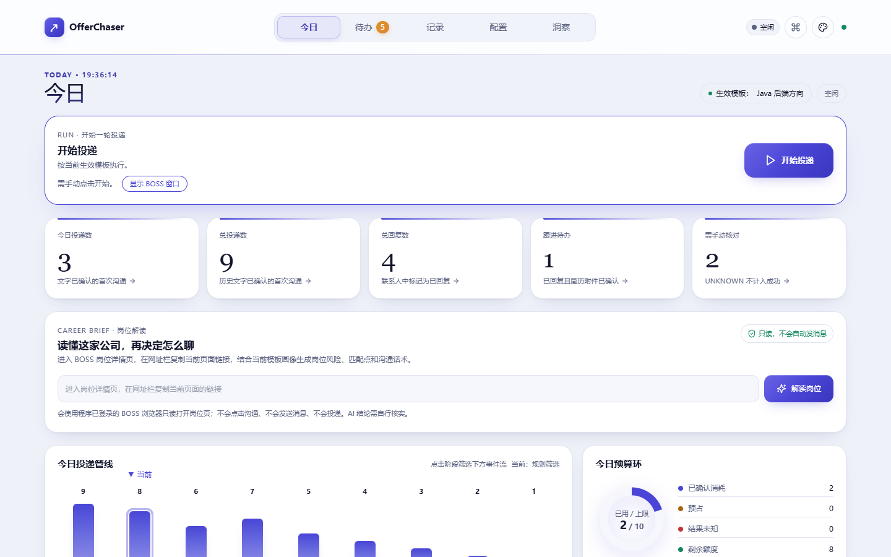 | 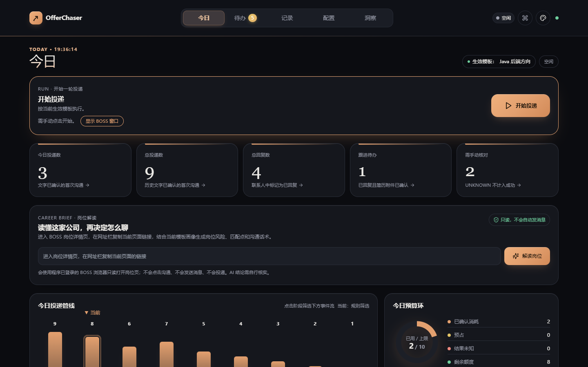 | 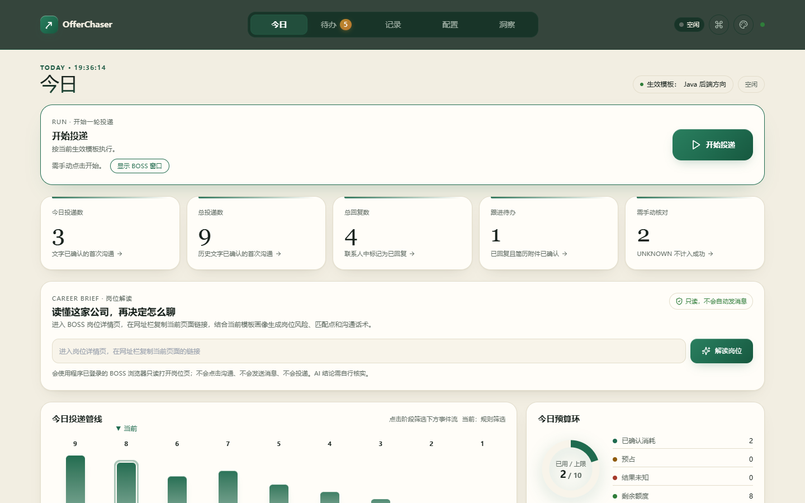 |

## 五个主空间（象牙松 / 绿色）

| 今日 | 待办 | 记录 |
|:---:|:---:|:---:|
|  | 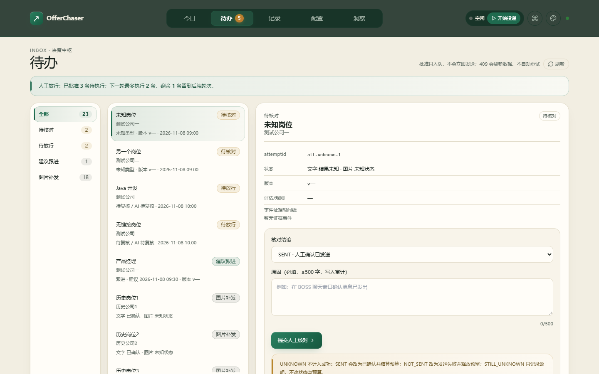 | 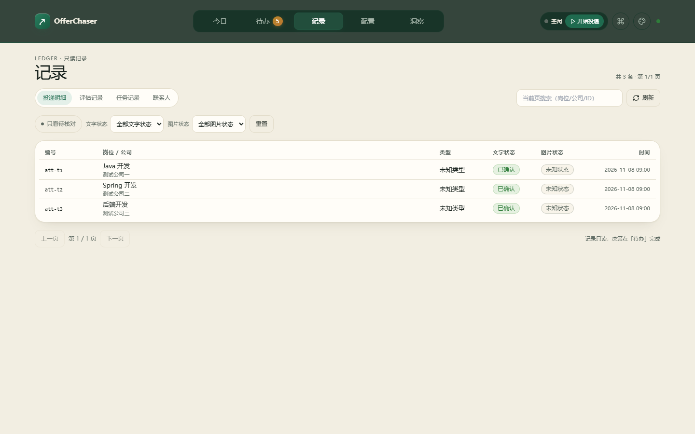 |

| 配置 | 洞察 | |
|:---:|:---:|:---:|
| 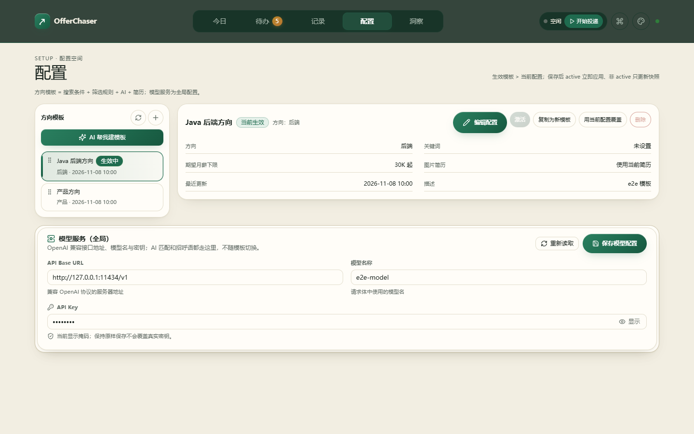 | 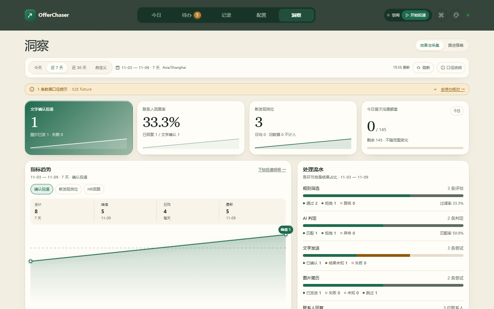 | |

## 子页面（象牙松 / 绿色）

| 分析 | 流程 | 跟进策略 |
|:---:|:---:|:---:|
| 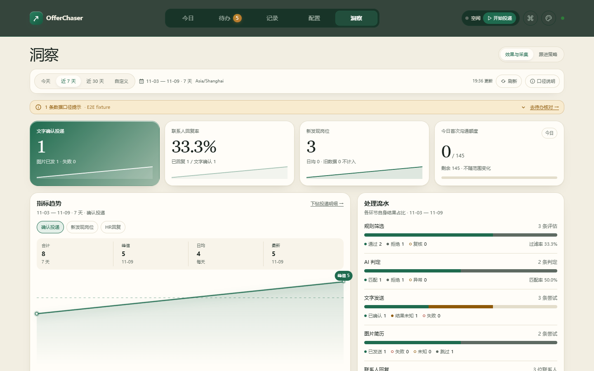 | 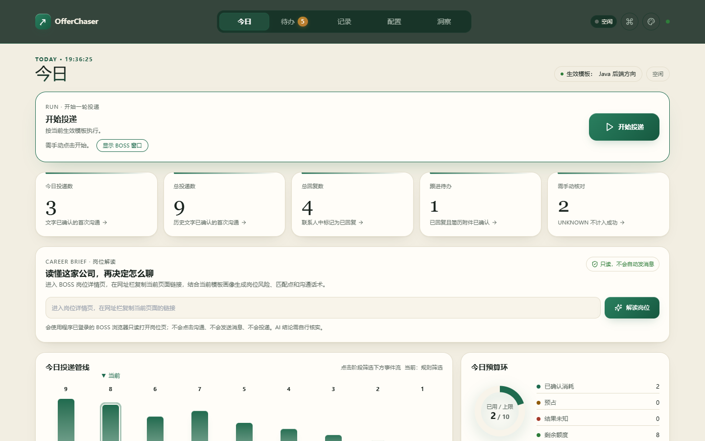 | 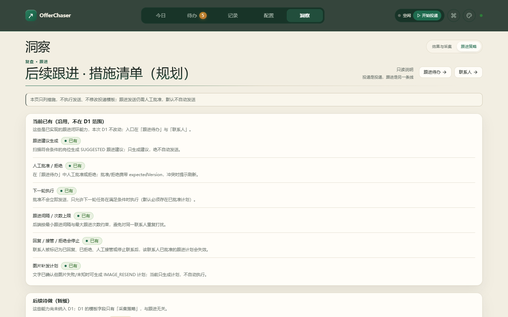 |

| 人工放行 | 建议跟进 | 任务记录 |
|:---:|:---:|:---:|
| 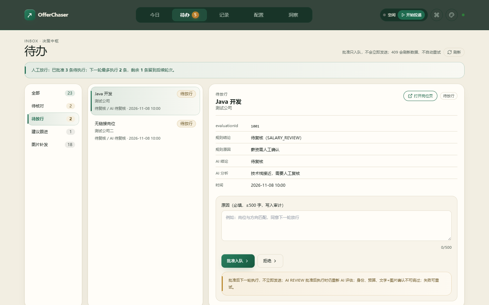 | 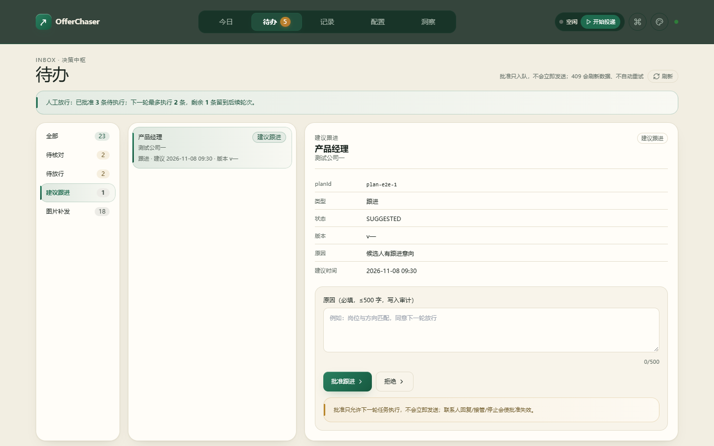 | 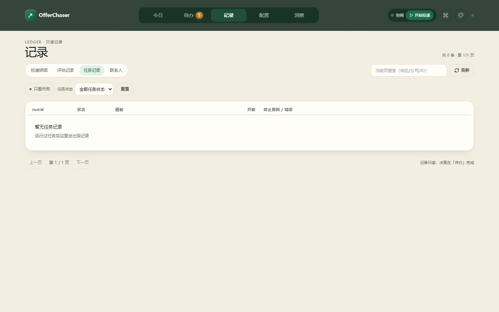 |

| 联系人 | 评估记录 | |
|:---:|:---:|:---:|
| 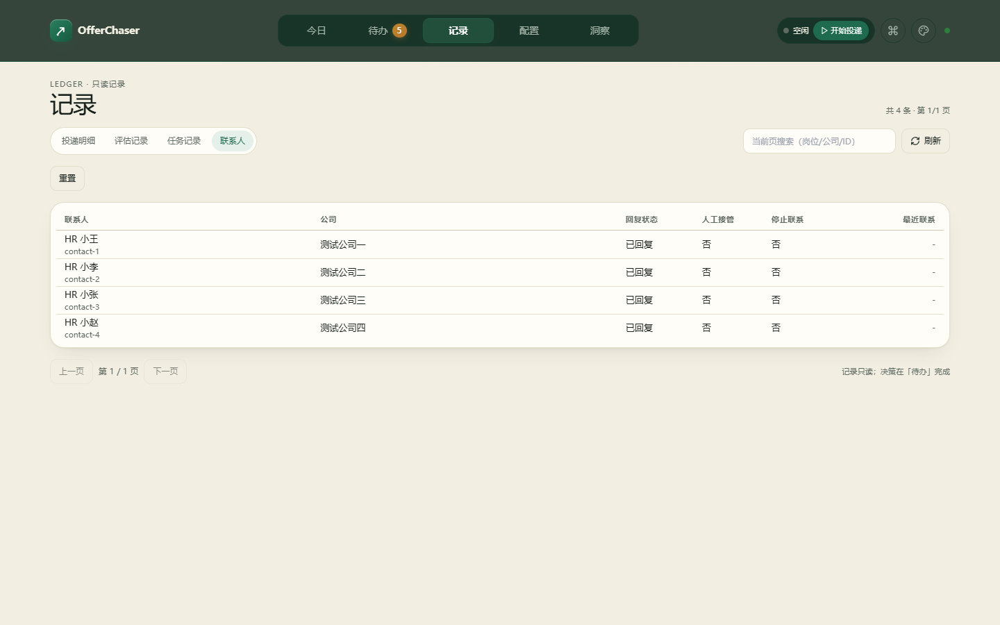 | 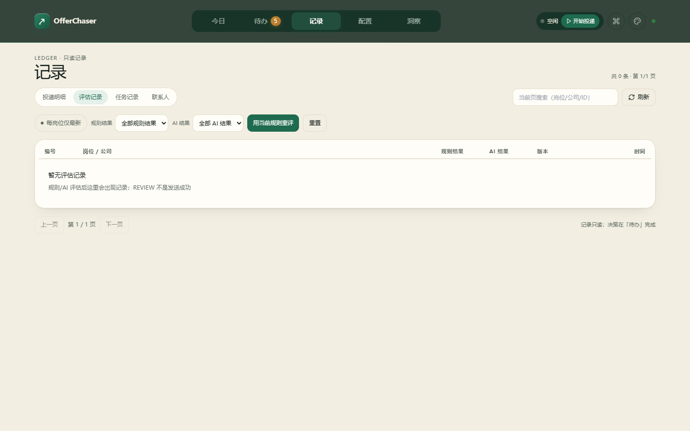 | |

> 截图由 `ManagementConsoleUiE2ETest` 的 mock fixture 生成；仅用于文档展示。
